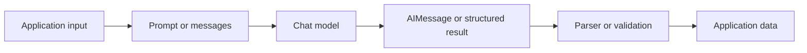
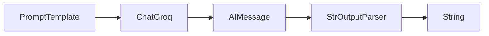
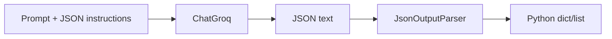
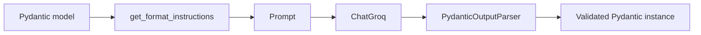
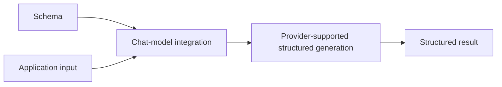
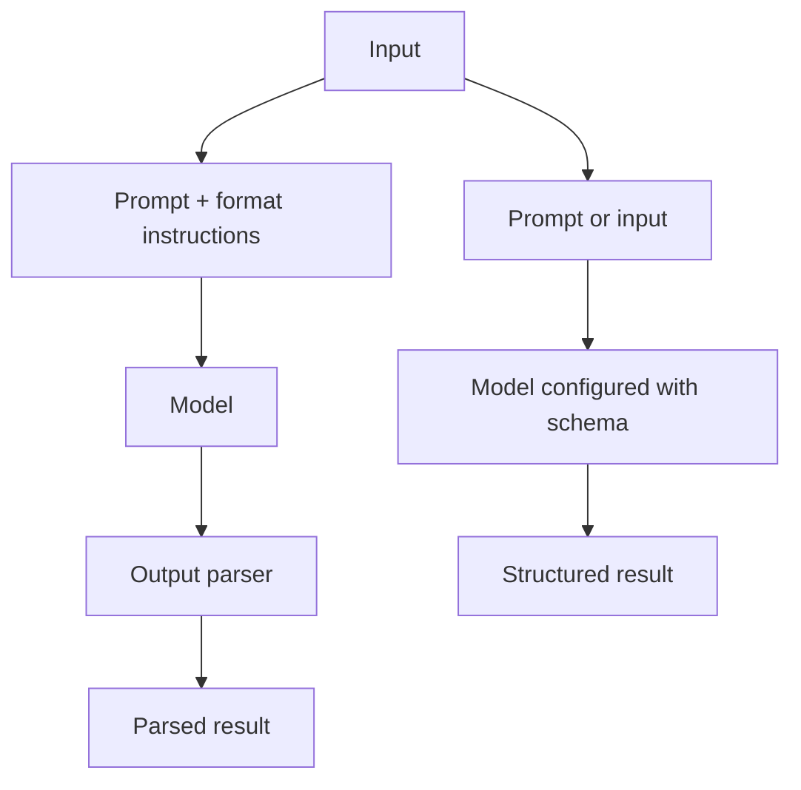

# Module 06 — Structured Output and Output Parsers

This module explores two related ways to make an LLM response easier for
Python code to consume:

1. **Output parsers**: ask the model for a format, then parse its response
   after the model has generated it.
2. **Structured output**: give a supported chat-model integration a schema and
   let the integration request and decode a structured result.

The examples use `ChatGroq` with the model identifier
`qwen/qwen3.8-27b`. The LangChain ideas in this README are portable, but
provider support, model support, and failure behavior are not identical across
integrations.

## Why structured output matters

A chat model normally returns conversational content. That is useful for
people, but application code often needs predictable data:

```text
Free-form answer:
"The review is mostly positive. The camera and battery are excellent..."

Machine-readable answer:
{
  "sentiment": "pos",
  "key_themes": ["camera", "battery"],
  "name": "Nitish Singh"
}
```

Structured output makes it easier to pass model results to a database, API,
UI, validator, or another program step. It does not make the model infallible:
the application still needs to handle provider errors, incomplete responses,
schema mismatches, and validation failures.

The general LangChain flow is:

```text
Application input
      ↓
Prompt template or input messages
      ↓
Chat model
      ↓
AIMessage or structured result
      ↓
Optional output parser / validation
      ↓
Application data
```

`PromptTemplate` prepares the request, the chat model generates a response,
and a parser or model integration converts that response into a useful Python
value. In LCEL, these components can be connected with `|` and invoked as one
Runnable.



## Experiment index

| File | Concept tested | Workflow | Important observation |
|---|---|---|---|
| [`01_str_output_parser.py`](./01_str_output_parser.py) | `StrOutputParser` | Prompt → `ChatGroq` → `StrOutputParser` | The parser returns the text content of the model response as a Python `str`. |
| [`02_json_output_parser.py`](./02_json_output_parser.py) | `JsonOutputParser` | Prompt + format instructions → model → JSON parser | The result is a Python dictionary (`dict`), not JSON text. |
| [`03_pydantic_output_parser.py`](./03_pydantic_output_parser.py) | `PydanticOutputParser` | Prompt + generated format instructions → model → Pydantic parser | The response is parsed into and validated against the `test` Pydantic model. |
| [`04_with_structured_pydantic.py`](./04_with_structured_pydantic.py) | Structured output with Pydantic | Pydantic schema + model integration → structured result | The model integration returns a `Review` instance rather than requiring a parser in the chain. |
| [`05_with_structured_typed_dict.py`](./05_with_structured_typed_dict.py) | Structured output with `TypedDict` | `TypedDict` schema + model integration → dictionary | The returned value is dictionary-shaped and is accessed with `result['name']`. |
| [`06_with_structured_json_schema.py`](./06_with_structured_json_schema.py) | Structured output with JSON Schema | JSON Schema dictionary + model integration → structured result | A schema can be supplied directly as a JSON-compatible dictionary. |
| [`07_approach_comparison.py`](./07_approach_comparison.py) | Approach comparison | Parser chain and structured-output chain for the same `Parser` model | Both approaches return a `Parser` instance here, but they use different workflows. |

The exact result can vary between runs because the examples call a remote
model. The comments in the Python files are observations from particular
runs, not guarantees for every request.

## 1. `StrOutputParser`

### What it does

Chat models generally return an `AIMessage`, which contains the model's
content and may also contain metadata, response information, or tool-call
data. `StrOutputParser` extracts the usable text content and returns a
string.

```text
PromptTemplate
      ↓
ChatGroq → AIMessage
      ↓
StrOutputParser
      ↓
str
```

This is the workflow implemented by
[`01_str_output_parser.py`](./01_str_output_parser.py):

```python
chain = prompt | model | parser
result = chain.invoke({"topic": "langchain"})
```



Use it when the next step needs ordinary text, such as a summary, explanation,
or another prompt input.

**Advantages**

- Minimal and easy to understand.
- Removes message-wrapper details from downstream code.
- Composes naturally with LCEL.

**Limitations**

- It does not define a schema.
- It does not validate that the model returned a particular meaning or
  structure.
- Text may still be incomplete or unsuitable for a downstream operation.

## 2. `JsonOutputParser`

### What it does

`JsonOutputParser` parses JSON-formatted model content into a Python data
structure. In the example, the model is asked for five facts and the parser
returns a dictionary containing a `facts` list:

```text
Prompt + JSON format instructions
      ↓
ChatGroq → JSON-looking text
      ↓
JsonOutputParser
      ↓
Python dict
```

See [`02_json_output_parser.py`](./02_json_output_parser.py). The parser's
format instructions are inserted with a `partial_variables` entry:

```python
parser = JsonOutputParser()
format_instruction = parser.get_format_instructions()
```

JSON text and a Python dictionary are different things:

```python
raw = '{"facts": ["one", "two"]}'  # str containing JSON
value = {"facts": ["one", "two"]}  # Python dict
```

The parser performs the conversion. It is not the same as merely printing
JSON-looking text.



**Advantages**

- Produces ordinary Python dictionaries/lists and works well for flexible
  JSON-shaped data.
- Useful when a full Pydantic model would be unnecessary.
- Supports streaming-oriented parsing behavior in LangChain's parser API,
  including parsing JSON that is still being assembled when the integration
  supports that usage.

**Limitations**

- The parser does not by itself guarantee that the model follows the
  requested shape or semantic constraints.
- Malformed or incomplete output can fail to parse. Partial JSON support is
  intended for incremental output, not a promise that arbitrary malformed
  JSON is acceptable as a final result.
- A plain dictionary does not automatically validate required keys, enum
  values, or business rules.

## 3. `PydanticOutputParser`

### What it does

`PydanticOutputParser` combines JSON parsing with Pydantic validation. The
developer defines a `BaseModel`, obtains format instructions, puts those
instructions into the prompt, and then parses the model's response.

[`03_pydantic_output_parser.py`](./03_pydantic_output_parser.py) defines:

```python
class test(BaseModel):
    name: list[str] = Field(description="name of cars")
    brand: list[str] = Field(description="Name of brands")
    Max_speed: list[str] = Field(description="max Speed of cars in Km/Hr")
```

Its flow is:

```text
n = 2
  ↓
PromptTemplate + parser.get_format_instructions()
  ↓
ChatGroq
  ↓
PydanticOutputParser
  ↓
test(name=[...], brand=[...], Max_speed=[...])
```

The format instructions tell the model what JSON shape to attempt. Pydantic
then constructs the model and validates the fields. If the response cannot be
parsed or does not satisfy the schema, invocation raises an error rather than
silently producing a valid-looking `test` object.



**Advantages**

- Gives the application a named, typed Pydantic object.
- Centralizes field definitions and runtime validation.
- Field descriptions can provide useful generation guidance.

**Limitations**

- The model still has to produce a parseable response.
- Format instructions consume prompt space and are not provider-level
  constrained decoding.
- Validation is post-generation; retries or error handling may be needed.
- Field descriptions guide generation but are not a substitute for a
  validation rule.

## Structured output with `with_structured_output()`

`with_structured_output(schema)` creates a model Runnable configured to return
the requested schema shape. It is distinct from manually composing
`PromptTemplate | model | parser`.

```text
Schema + provider/model integration
              ↓
        Structured result
```

The exact implementation is integration-specific. Depending on the provider
and options, the integration may use native structured response support, tool
calling, JSON mode, or another supported mechanism. Do not assume that every
chat model enforces schemas in the same way.



### Pydantic schema

[`04_with_structured_pydantic.py`](./04_with_structured_pydantic.py) passes a
Pydantic model:

```python
structured_model = model.with_structured_output(Review)
result = structured_model.invoke(review_text)
```

The result is a `Review` instance. `BaseModel` supplies a class-based schema;
annotations describe types; `Field` supplies descriptions, defaults, and
validation metadata; and Pydantic validates the constructed object.

Required and optional fields are not the same:

```python
class Item(BaseModel):
    required_name: str
    optional_note: str | None = Field(default=None)
```

`required_name` must be supplied. `optional_note` may be `None` because it has
both an optional type and a default. A type annotation alone does not always
make a field optional in Pydantic; the default matters too.

### `TypedDict` schema

[`05_with_structured_typed_dict.py`](./05_with_structured_typed_dict.py)
defines the expected dictionary shape:

```python
class Review(TypedDict):
    key_themes: Annotated[list[str], "themes"]
    summary: Annotated[str, "summary"]
    sentiment: Annotated[Literal["pos", "neg"], "sentiment"]
    name: Annotated[Optional[str], "reviewer"]
```

The result is used as a dictionary (`result['name']`). `TypedDict` primarily
describes the expected shape to type checkers and integrations. It does not
create a Pydantic object and does not independently perform Pydantic-style
runtime validation when a dictionary is created in ordinary Python code.

The `total` setting and `NotRequired`/`Required` can describe required and
optional keys when supported by the Python and LangChain versions in use.
That is different from making a value nullable: an optional key may be
absent, while a present key may still have a non-`None` type.

### JSON Schema

[`06_with_structured_json_schema.py`](./06_with_structured_json_schema.py)
passes a JSON-compatible dictionary containing `type`, `properties`,
`description`, `enum`, and `required`. JSON Schema is language-independent and
can be exchanged with APIs and other tools.

The result type depends on the integration's documented behavior and options;
in this experiment it is printed directly rather than accessed as a Pydantic
object. A JSON Schema describes constraints, but only constraints supported by
the provider/integration can be enforced during generation. Application-side
validation may still be appropriate.

## `Annotated` and `Field`

These two features are related, but they are not interchangeable.

### `Annotated`

`typing.Annotated[T, metadata]` keeps `T` as the underlying type while
attaching metadata that tools can inspect:

```python
from typing import Annotated

title: Annotated[str, "A short title"]
```

The string metadata does not turn `title` into a different Python type and
does not, by itself, validate a value. LangChain integrations can inspect
metadata in supported schema forms and use descriptions as generation
guidance. `Annotated` is not required for every schema; plain annotations
also work.

### Pydantic `Field`

`Field` is a Pydantic helper for declaring field metadata and behavior:

```python
from pydantic import BaseModel, Field

class Product(BaseModel):
    name: str = Field(description="Product name")
    rating: int = Field(ge=1, le=5)
```

The description can help the model choose what to generate. `ge=1` and
`le=5`, however, are validation constraints. A description such as
`"rating from 1 to 5"` is only guidance unless a real constraint is declared.

`Field` can also be used as metadata inside `Annotated` in Pydantic-supported
forms:

```python
rating: Annotated[int, Field(ge=1, le=5, description="Rating")]
```

In the TypedDict experiment, metadata is attached with `Annotated`; the
experiment does not use Pydantic `Field`. Use the schema form documented by
the selected LangChain integration rather than assuming every combination is
accepted by every provider.

## The most important distinction

### Approach A: manually composed output parser

```text
Prompt → Model → Output Parser → Parsed Result
```

This approach explicitly asks the model for a format and then parses the
generated content. `PydanticOutputParser` is responsible for parsing and
Pydantic validation after generation. `JsonOutputParser` converts JSON text
to Python data but does not define a full named model.

### Approach B: structured output

```text
Schema + Model Integration → Structured Result
```

This approach configures the chat-model integration up front. The provider may
support a native structured response or a tool-calling/JSON mechanism. The
integration handles the response conversion according to its documented
behavior.

| Comparison | Parser chain | Structured output |
|---|---|---|
| Pydantic | `PydanticOutputParser` plus format instructions | `with_structured_output(PydanticModel)` |
| JSON | `JsonOutputParser` plus JSON-oriented instructions | `with_structured_output(JSON Schema)` |
| TypedDict | Not the focus of these parser examples | `with_structured_output(TypedDict)` |
| Input | Usually model text / `AIMessage` | Model input plus schema configuration |
| Output | `str`, `dict`, or Pydantic instance | Integration-defined structured result, commonly dict or Pydantic instance |
| Schema location | Parser and often the prompt | Schema passed to the model integration |
| Format instructions | Usually needed for parser-driven structure | May be generated or enforced by the integration |
| Validation | Parser/Pydantic after generation | Provider and/or integration behavior, plus optional application validation |
| Provider dependency | Parser logic is relatively general, but the model must follow instructions | Stronger dependency on provider and model capabilities |
| Failure modes | Invalid JSON, missing fields, Pydantic validation errors | Unsupported schema, provider error, refusal, malformed result, or validation error |
| Best use case | Portable, explicit LCEL pipelines and learning parsing | Supported provider integrations where structured generation is desirable |

Similar return types do not mean the two approaches are equivalent. The
comparison in [`07_approach_comparison.py`](./07_approach_comparison.py)
creates both chains for a small `Parser` model. It demonstrates that both can
produce a `Parser` instance while differing in how the format is supplied and
how the model integration is configured.



## Groq and model-specific context

The following are LangChain concepts:

- Runnable composition with `|`.
- `StrOutputParser`, `JsonOutputParser`, and `PydanticOutputParser`.
- Pydantic, `TypedDict`, and JSON Schema as schema representations.
- `with_structured_output()` as the chat-model integration API.

The following depend on Groq and the selected model:

- Whether `qwen/qwen3.8-27b` is available to the account at execution time.
- Which structured-output method `ChatGroq` selects internally.
- Which schema features the model/provider supports.
- Token limits, refusals, latency, and exact generated values.

Groq documents structured outputs separately from ordinary JSON mode. Its
strict JSON Schema mode has additional schema requirements and only applies
to supported models and supported schema features. The examples in this
module do not pass a `strict=True` option, so they should not be described as
demonstrating guaranteed strict decoding. Consult the current documentation
before relying on provider-level guarantees:

- [LangChain ChatGroq integration](https://python.langchain.com/docs/integrations/chat/groq/)
- [LangChain structured output concepts](https://python.langchain.com/docs/concepts/structured_outputs/)
- [Groq Structured Outputs](https://console.groq.com/docs/structured-outputs)

These links are intentionally included because provider support changes more
quickly than the surrounding LangChain concepts.

## Common mistakes and troubleshooting

### JSON text versus a Python dictionary

`'{"x": 1}'` is a string. `{"x": 1}` is a dictionary. Use
`JsonOutputParser` or a JSON decoder when conversion is required; do not test
the type by looking only at printed output.

### Missing parser format instructions

The Pydantic and JSON parser experiments call `get_format_instructions()` and
insert the result into the prompt. Omitting that step makes the model more
likely to return prose or the wrong shape. It still does not guarantee
success.

### Schema and prompt disagree

Keep requested fields, allowed values, and descriptions consistent. In the
TypedDict and JSON Schema examples, the description says “negative, positive
or neutral,” but the actual `Literal`/`enum` allows only `"pos"` and `"neg"`.
The code therefore does **not** support `"neutral"` as written.

### Treating descriptions as validators

Descriptions are useful generation hints. They do not enforce a value range
or enum. Use Pydantic constraints or JSON Schema constraints where the
integration supports them, and validate important data in application code.

### Provider or model errors

Check the provider's current supported-model and structured-output
documentation. A schema can be valid JSON Schema and still be unsupported by
the selected model or integration.

### Truncated or malformed output

The examples set `max_tokens`. A response that is truncated, refuses the
request, or contains malformed JSON can cause parsing or validation errors.
Inspect the original exception and response metadata, then consider a larger
budget, a smaller schema, a retry strategy, or application-level validation.

### Missing package or API key

The experiments import `langchain_groq` and call `load_dotenv()`. Install the
Groq LangChain integration in the environment used to run the files and set
the provider API key in the expected environment configuration. The current
root [`requirements.txt`](../../requirements.txt) does not list
`langchain-groq`, so dependency setup should be checked separately before
running these examples.

## Choosing an approach

| Choose | When |
|---|---|
| `StrOutputParser` | You need ordinary text and do not need a schema. |
| `JsonOutputParser` | You need flexible JSON-shaped Python data and can handle missing or invalid fields yourself. |
| `PydanticOutputParser` | You want explicit post-generation Pydantic parsing and validation in an LCEL chain. |
| `with_structured_output(PydanticModel)` | The selected integration supports it and you want a typed, validated Pydantic result. |
| `with_structured_output(TypedDict)` | You want a dictionary-shaped schema with lightweight typing metadata and the integration supports it. |
| `with_structured_output(JSON Schema)` | You need a language-independent schema or provider/API-compatible JSON Schema. |

## Completion checklist

After completing this module, you should be able to:

- Explain why a chat model commonly returns an `AIMessage` and when to use
  `StrOutputParser`.
- Distinguish JSON text, a Python dictionary, and a Pydantic instance.
- Explain why parser format instructions help but do not guarantee valid
  output.
- Describe what Pydantic validates and what `TypedDict` does not validate at
  runtime by itself.
- Explain the roles of `Annotated`, `Field`, descriptions, and actual
  validation constraints.
- Draw the difference between a parser chain and structured model output.
- Identify which behaviors come from LangChain and which depend on Groq or
  the selected model.
- Read the schema in files `04–06` and predict the likely output type and
  allowed values before running the code.
- Add explicit error handling and validation before sending model output to a
  production database or API.
