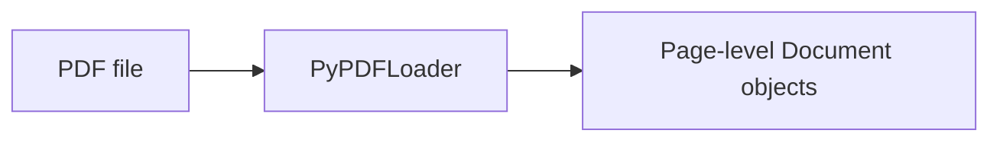

# Module 07 — Document Loaders

Document loaders convert content from an external source into LangChain
`Document` objects. This gives later LangChain components one common
representation, whether the source was a text file, PDF, CSV, web page, or
JSON file.

## The core idea

A LangChain `Document` normally contains:

- `page_content`: the text that can be searched, embedded, summarized, or
  passed to a model.
- `metadata`: context about that text, such as its source path, row number, or
  page number.

Loading is not the same as splitting. A loader reads and represents the source;
it does not automatically divide a long `page_content` string into retrieval
chunks. Splitting is a separate step.


This is the beginning of a typical RAG pipeline. This module focuses on the
loader stage; text splitters, embeddings, and vector stores are separate
concerns.

## Experiment index

| File | Purpose | Main concept |
|---|---|---|
| [`01_text_loader.py`](./01_text_loader.py) | Loads `sample_notes.txt` with UTF-8 encoding. | One text file becomes a list containing a `Document`. |
| [`02_pdf_loader.py`](./02_pdf_loader.py) | Loads `sample_handout.pdf` and summarizes the first document with a model. | A PDF can produce page-level documents; the script uses `doc[0].page_content`. |
| [`03_csv_loader.py`](./03_csv_loader.py) | Loads `sample_students.csv`. | Each CSV row becomes one document with row metadata. |
| [`04_webbase_loader.py`](./04_webbase_loader.py) | Loads `https://books.toscrape.com/` and summarizes the first document. | Web content is fetched and represented as document text. |
| [`05_directory_loader.py`](./05_directory_loader.py) | Finds `*.txt` files in `directory_samples` using `TextLoader`. | `DirectoryLoader` applies an individual file loader across matching files. |
| [`06_json_loader.py`](./06_json_loader.py) | Selects `.records[]` from `sample_records.json`. | `jq_schema` chooses which JSON values become documents. |

The examples print or use the loaded documents. Their commented outputs are
sample observations, not guarantees for every environment or remote request.

## Loader workflows

### `TextLoader`

Source: [`sample_notes.txt`](./sample_notes.txt)


[`01_text_loader.py`](./01_text_loader.py) calls `load()` and prints the
resulting list, then inspects `doc[0].page_content` and `doc[0].metadata`.
For this example, the content is one text document and metadata includes the
source path.

**Practical consideration:** pass the correct `encoding` for the file.
Relative paths are resolved from the process's current working directory, not
necessarily from the Python file's directory.

### `PyPDFLoader`

Source: [`sample_handout.pdf`](./sample_handout.pdf)



[`02_pdf_loader.py`](./02_pdf_loader.py) loads the PDF and sends
`doc[0].page_content` to a prompt for summarization. A single PDF can return
multiple `Document` objects because the loader commonly represents each page
separately. Page-related metadata can identify where text came from.

**Practical consideration:** PDF extraction depends on the PDF structure.
Scanned pages, unusual layouts, tables, and images may not produce the text
you expect even when the PDF opens normally.

### `CSVLoader`

Source: [`sample_students.csv`](./sample_students.csv)


[`03_csv_loader.py`](./03_csv_loader.py) turns each row into one document.
The sample content is represented like:

```text
student_id: S101
name: Aarav
subject: Operating Systems
score: 84
```

The source path and zero-based row number are stored in metadata.

**Practical consideration:** choose or configure the column formatting when
the default `column: value` representation is not suitable for your search or
prompting task.

### `WebBaseLoader`

Source: `https://books.toscrape.com/`


[`04_webbase_loader.py`](./04_webbase_loader.py) loads the page, uses
`doc[0].page_content`, and sends it to a summarization chain. A web page may
contain navigation, menus, boilerplate, or incomplete client-rendered
content; the loader does not guarantee clean article text.

**Practical consideration:** a URL opening in a browser does not prove that a
Python request will succeed. The site may require headers, cookies,
authentication, JavaScript execution, rate-limit handling, or may block the
HTTP client's user agent.

### `DirectoryLoader`

Source: [`directory_samples`](./directory_samples)


[`05_directory_loader.py`](./05_directory_loader.py) uses
`DirectoryLoader` with `glob='*.txt'` and `loader_cls=TextLoader`.
`DirectoryLoader` is an orchestrator: it finds matching files and delegates
each file to the selected individual loader. It is not a replacement for
`TextLoader`, `PyPDFLoader`, or another format-specific loader.

**Practical consideration:** check the glob pattern and directory path. A
wrong pattern can produce no documents, while a broad pattern can attempt to
load unsupported files.

### `JSONLoader`

Source: [`sample_records.json`](./sample_records.json)

```mermaid
flowchart LR
    A[JSON file] --> B[JSONLoader]
    B --> C[jq_schema: .records[]]
    C --> D[Documents for selected JSON values]
```

[`06_json_loader.py`](./06_json_loader.py) uses:

```text
jq_schema=".records[]"
text_content=False
```

The query `.records[]` means: go to the top-level `records` array and select
each element of that array. In the sample, each selected record is an object
such as `{ "id": "DOC001", ... }`.

**Practical consideration:** make the query match the actual JSON shape.
Whether an object, array, or scalar becomes usable `page_content` depends on
the loader configuration and the selected content. `text_content=False` is
important when selected values are not plain text and should be represented as
JSON data.

## Important confusions

### Why not import these loaders from `langchain_core`?

`langchain_core` contains shared abstractions such as `Document`, Runnable
interfaces, prompts, and parsers. Concrete loaders often depend on third-party
libraries, network clients, file formats, or provider-specific behavior, so
they live in `langchain_community` or dedicated integration packages.

The experiments import their loaders from `langchain_community.document_loaders`.
The `Document` abstraction is the common result, not the implementation of
every source connector.

### `Document`, `page_content`, and `metadata`

These are different levels:

```text
Document
├── page_content  -> the text/data used by the application
└── metadata      -> source and contextual information
```

`doc[0].page_content` is the content of one document. `doc[0].metadata` is a
dictionary of context. `loader.load()` generally returns a list because one
source can naturally produce multiple documents.

### Why multiple documents for one PDF?

PDFs have pages, and page-level documents preserve useful boundaries and
metadata. Therefore one file can become one document per page. The exact
behavior depends on the loader and its configuration; it is not a rule that
every PDF becomes exactly one document.

### How does `CSVLoader` represent rows?

It treats each row as a separate document. Column names become labels in
`page_content`, while metadata identifies the source and row index. This is
useful when retrieving or processing records independently.

### `DirectoryLoader` versus an individual loader

`TextLoader` answers “how do I read one text file?” `DirectoryLoader` answers
“which files should I find, and which loader should read each one?” In this
module, the directory loader finds `*.txt` files and uses `TextLoader` for each.

### `jq_schema` versus `content_key`

`jq_schema` is a query that selects values from the JSON document. For
example, `.records[]` selects every item in the `records` array.

`content_key` is a separate setting used when each selected item is an object
and one particular field should become the document's text content. Conceptually:

```json
{"records": [{"title": "Deadlocks", "body": "Notes..."}]}
```

- `.records[]` selects each record object.
- `content_key="body"` selects the `body` field from each selected object as
  the content.

Do not confuse “which records are selected?” with “which field inside each
record is content?”. The exact combination must match the installed
`JSONLoader` version and its documented options.

If a query selects an object or array while the loader is configured for plain
text, conversion can fail or produce an unsuitable representation. Inspect the
JSON shape and decide whether the selected value should be serialized JSON
(`text_content=False`) or whether a string field should be selected.

## Dependencies and common errors

| Loader | Import used in this module | Relevant dependency |
|---|---|---|
| `TextLoader` | `langchain_community.document_loaders` | `langchain-community` |
| `PyPDFLoader` | `langchain_community.document_loaders` | `pypdf` for PDF extraction |
| `CSVLoader` | `langchain_community.document_loaders` | `langchain-community` |
| `WebBaseLoader` | `langchain_community.document_loaders` | HTTP/HTML parsing dependencies used by the integration |
| `DirectoryLoader` | `langchain_community.document_loaders` | `langchain-community` plus the selected file loader's dependency |
| `JSONLoader` | `langchain_community.document_loaders` | `jq` support and the loader's JSON dependencies |

Common problems in these experiments include:

- **Import error:** the loader package or format dependency is missing.
- **`FileNotFoundError`:** the relative path is being resolved from a
  different working directory.
- **PDF errors or empty text:** the PDF is scanned, encrypted, malformed, or
  uses a layout that is difficult to extract.
- **JSON errors:** the file is invalid JSON, `jq_schema` does not match it, or
  the selected value does not fit the configured content mode.
- **Web loading errors:** network access, TLS, robots/rate limits, headers,
  authentication, or JavaScript-rendered content can affect the request.

A package can be installed globally and still be unavailable to the script.
Always check the Python environment and interpreter that actually runs the
file, especially when using a virtual environment, conda environment, IDE,
or notebook kernel.

The repository's root [`requirements.txt`](../../requirements.txt) lists
`langchain_community` but does not explicitly list every format-specific
dependency used by these loaders. Install and verify the relevant integration
dependency in the same environment as the script.

## Choosing a loader

| Source | First choice |
|---|---|
| Plain text file | `TextLoader` |
| PDF | `PyPDFLoader` |
| CSV records | `CSVLoader` |
| Web page | `WebBaseLoader` |
| Directory of files | `DirectoryLoader` plus the appropriate file loader |
| JSON records | `JSONLoader` with a query matching the JSON shape |

## Completion checklist

You understand this module when you can:

- Explain the roles of `page_content` and `metadata`.
- Explain why `load()` returns a list and why one source can create multiple
  documents.
- Choose a loader for text, PDF, CSV, web, directory, and JSON sources.
- Explain why loading does not automatically split text into chunks.
- Read `.records[]` and describe which JSON values it selects.
- Distinguish `jq_schema` from `content_key`.
- Diagnose a missing dependency, invalid path, malformed input, or web request
  failure in the environment running the script.

