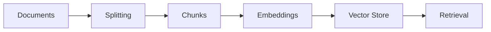
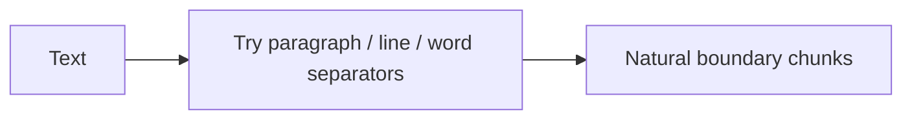
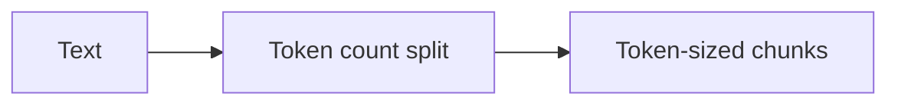
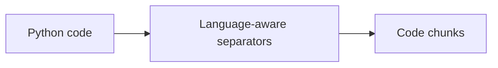

# Module 08 — Text Splitters

## Overview

Text splitting breaks large documents into smaller chunks before embedding and retrieval. In RAG, this matters because chunking affects retrieval quality, context coverage, and token cost.

- Large documents are split into manageable pieces.
- Each chunk is embedded and stored in a vector store.
- Retrieval fetches the most relevant chunks for a query.
- Good chunks are small enough to retrieve precisely but large enough to retain useful context.

Chunking is a preprocessing choice, not a replacement for a retriever. The best
strategy depends on the source format, embedding model, model context window,
and the questions users are likely to ask.

## Conceptual workflow



## Experiments

### 01_character_text_splitter.py

`CharacterTextSplitter` splits text using a configured separator. It is useful for simple plain-text chunking when you want predictable, separator-based boundaries.

- Use it for: basic text segmentation with a fixed chunk size.
- Limitation: chunk lengths may not match the target size exactly, and separator-based splitting can cut awkwardly across natural boundaries.

The experiment configures an empty separator, `chunk_size=200`, and
`chunk_overlap=0`:

```python
splitter = CharacterTextSplitter(
    chunk_size=200,
    chunk_overlap=0,
    separator="",
)
chunks = splitter.split_text(text)
```


### 02_recursive_character_text_splitter.py

`RecursiveCharacterTextSplitter` tries preferred separators first (`\n\n`, `\n`, space, then smaller boundaries) before falling back to tighter splits. This is often the default choice for general text because it preserves natural structure better than a single fixed separator.

- Use it for: long prose, notes, and general document chunking.
- Limitation: it is still text-based and not semantic; it does not understand meaning or document structure.

The experiment uses a 300-character target and 50-character overlap. The
default recursive preference is effectively paragraph, line, word, and then
character boundaries. It tries the preferred separators before falling back to
smaller boundaries.



### 03_token_text_splitter.py

`TokenTextSplitter` splits by token count rather than character count, which is important when model context windows and token budgets matter.

- Use it for: token-aware chunking when you need chunks sized for LLM limits.
- Limitation: it is token-based, not character-based, and chunk boundaries can feel less intuitive because tokenization is encoding-dependent.

The experiment uses the `cl100k_base` encoding with `chunk_size=100` and
`chunk_overlap=20`:

```python
splitter = TokenTextSplitter(
    encoding_name="cl100k_base",
    chunk_size=100,
    chunk_overlap=20,
)
```

The printed character length is only an observation; it is not the sizing
criterion.



### 04_markdown_text_splitter.py

`MarkdownHeaderTextSplitter` splits Markdown by heading levels and stores heading information in each chunk's metadata. This preserves section context across a document.

- Use it for: structured docs, notes, docs pages, and Markdown knowledge bases.
- Limitation: it does not directly configure `chunk_size` or `chunk_overlap`; when size limits matter, it is often followed by recursive splitting.

This experiment recognizes `#`, `##`, and `###` as `Header 1`, `Header 2`,
and `Header 3`. A returned `Document` contains both `page_content` and
metadata such as:

```python
{"Header 1": "LangChain", "Header 2": "Text Splitters"}
```

For long sections, use a two-stage pipeline:

```text
MarkdownHeaderTextSplitter → RecursiveCharacterTextSplitter
```

The first stage preserves section metadata; the second enforces practical
size and overlap limits.


### 05_code_text_splitter.py

`RecursiveCharacterTextSplitter.from_language(language=Language.PYTHON, ...)` applies Python-aware separators to code. It helps preserve code structure better than generic text splitting.

- Use it for: Python source files and code-heavy documents.
- Limitation: language-aware separators improve structure preservation but do not guarantee intact functions or classes in every case.

The experiment uses the Python language preset:

```python
splitter = RecursiveCharacterTextSplitter.from_language(
    language=Language.PYTHON,
    chunk_size=200,
    chunk_overlap=20,
)
```

This is structure-aware separator selection, not a Python parser. A function
or class can still be divided when the configured size requires it.



## Comparison

| File | Strategy | Best use case | Key limitation |
|---|---|---|---|
| `01_character_text_splitter.py` | Separator-based text splitting | Simple text chunking | Chunks may not match target size exactly |
| `02_recursive_character_text_splitter.py` | Recursive separator fallback | General prose and documents | Not semantic; may still split awkwardly |
| `03_token_text_splitter.py` | Token-based splitting | LLM/token-budget-aware chunks | Tokenization can be less intuitive than character counting |
| `04_markdown_text_splitter.py` | Heading-based Markdown splitting | Structured docs with section context | No direct `chunk_size` / `chunk_overlap` controls |
| `05_code_text_splitter.py` | Language-aware recursive splitting for Python | Code indexing and code retrieval | Does not guarantee intact functions/classes |

## Key learnings

- `chunk_size`: target size for each chunk. Larger chunks preserve more context but may reduce retrieval precision; smaller chunks improve granularity but may lose surrounding information.
- `chunk_overlap`: overlap keeps neighboring chunks connected at boundaries and reduces context loss when content crosses chunk limits.
- Token-based sizing: `TokenTextSplitter` measures by token count, which is often more relevant than character count for LLM workflows.
- Heading metadata: `MarkdownHeaderTextSplitter` preserves header structure in metadata, so retrieval can keep section-level context.
- Language-aware code splitting: `RecursiveCharacterTextSplitter.from_language(language=Language.PYTHON, ...)` is better for code than generic splitting, but it still does not guarantee perfect function/class boundaries.
- There is no universally correct chunk size. Evaluate retrieval with representative queries instead of choosing a value by character count alone.

## Other chunking approaches

These approaches are useful extensions, but are not implemented by the five
experiments in this folder:

| Approach | Idea | Trade-off |
|---|---|---|
| Semantic chunking | Split when the meaning or embedding similarity changes substantially | More compute and threshold tuning |
| Structure-aware parsing | Use HTML, XML, JSON, PDF layout, or AST boundaries | Depends on reliable source parsing |
| Parent-child retrieval | Embed small child chunks but return a larger parent section | Better context, with more indexing and retrieval logic |
| Contextual chunking | Add document or section context to each chunk before embedding | Can improve retrieval, but increases token and storage cost |
| Agentic/query-aware chunking | Choose or refine boundaries based on expected questions | Flexible, but slower and harder to make deterministic |

Short syntax ideas:

```python
# Semantic chunking idea
chunks = semantic_splitter.split_documents(docs)

# Structure-aware parsing idea
docs = HTMLSectionSplitter(headers_to_split_on=[("h1", "H1"), ("h2", "H2")]).split_text(text)

# Parent-child retrieval idea
child_chunks = splitter.split_documents(docs)
vectorstore.add_documents(child_chunks)

# Contextual chunking idea
chunk_text = f"Section: {section_title}\n{chunk.page_content}"

# Agentic/query-aware chunking idea
chunks = splitter.split_text(text)  # refine boundaries with query-aware logic before indexing
```

In practice, a hybrid pipeline is common: preserve source structure first,
apply a size limit second, and validate the result with retrieval evaluation.

## Setup and execution

Install the package used by the imports in these experiments:

```bash
pip install langchain-text-splitters
```

Run any example directly:

```bash
python modules/08_text_splitters/01_character_text_splitter.py
python modules/08_text_splitters/02_recursive_character_text_splitter.py
python modules/08_text_splitters/03_token_text_splitter.py
python modules/08_text_splitters/04_markdown_text_splitter.py
python modules/08_text_splitters/05_code_text_splitter.py
```

These scripts focus on chunking logic only; they do not include a full vector database pipeline.

The imports used by the experiments are provided by the
`langchain-text-splitters` package. The examples use no API keys, model
provider, or vector-store credentials.
