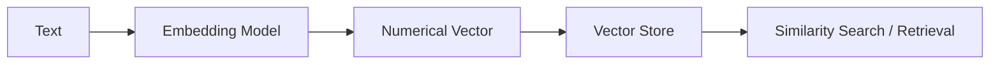
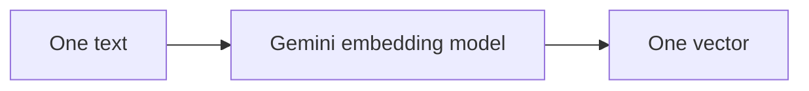
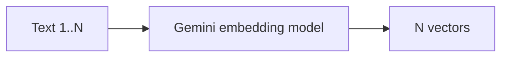
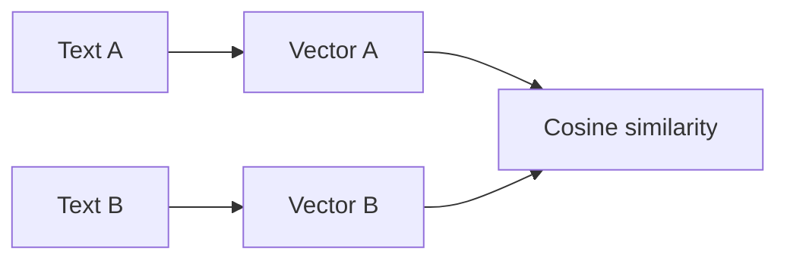
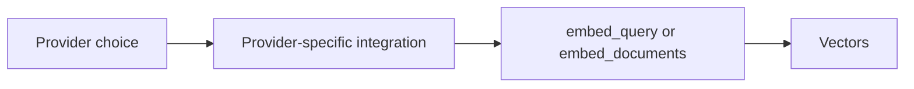

# Module 09 — Embeddings

Embeddings convert text into numerical vectors that capture meaning and relationships. Text with similar meaning tends to occupy nearby positions in vector space, which makes embeddings useful for semantic search, clustering, recommendations, and retrieval-augmented generation (RAG). In RAG, a query and document chunks are embedded in the same vector space so relevant context can be retrieved before an LLM generates an answer.

## Visual workflow



This module focuses on generating embeddings and calculating basic similarity. Persistent vector storage and indexing are introduced in Module 10 — Vector Stores.

## Experiments

### `01_embeddings_basic.py`

**Concept:** Generate one query embedding with Google Gemini.

**Learnings**

- `embed_query(text)` returns one vector for one input string.
- `gemini-embedding-001` defaults to 3,072 dimensions; the example shows how to request 768 dimensions with `output_dimensionality`.



### `02_document_embeddings.py`

**Concept:** Embed a collection of documents.

**Learnings**

- `embed_documents(texts)` returns one vector per input text.
- The number of vectors equals the number of input texts; each vector has the configured dimensionality.



### `03_similarity_search.py`

**Concept:** Compare two text embeddings with cosine similarity.

**Learnings**

- `cosine_similarity()` expects 2D arrays shaped like `(samples, features)`, so `vectors[0:1]` preserves a sample axis.
- A score closer to `1` indicates stronger directional similarity; it is not a probability or proof that meanings are identical.



### `04_embedding_provider_reference.py`

**Concept:** Compare reusable LangChain embedding-provider configurations.

**Learnings**

- Provider integrations share the `Embeddings` interface, but model IDs, authentication, and optional parameters differ.
- The active example uses Gemini; the other providers are commented provider references.



## Reusable provider reference

Model names and availability change. The links in this table are the authoritative places to check current model catalogs, limits, and pricing before deployment.

| Provider | Example embedding model | LangChain package | Execution | Authentication / cost | Primary use case |
|---|---|---|---|---|---|
| [Google Gemini](https://ai.google.dev/gemini-api/docs/embeddings) | `gemini-embedding-001` | `langchain-google-genai` | Hosted API | `GOOGLE_API_KEY`; quota and pricing depend on account ([details](https://ai.google.dev/pricing)) | General, multilingual, and code semantic search |
| [OpenAI](https://platform.openai.com/docs/guides/embeddings) | `text-embedding-3-small` | `langchain-openai` | Hosted API | `OPENAI_API_KEY`; paid API ([pricing](https://openai.com/api/pricing/)) | Cost-conscious production search and RAG |
| [Hugging Face](https://huggingface.co/sentence-transformers/all-MiniLM-L6-v2) | `sentence-transformers/all-MiniLM-L6-v2` | `langchain-huggingface` | Local by default; hosted inference is also available | Local needs no key; hosted uses `HF_TOKEN` and has model/provider limits ([docs](https://huggingface.co/docs/huggingface_hub/en/package_reference/inference_client)) | Private/local semantic similarity and experimentation |
| [Ollama](https://ollama.com/library/nomic-embed-text) | `nomic-embed-text` | `langchain-ollama` | Local Ollama service | No provider API key; install Ollama and run/pull the model | Offline development and local RAG |
| [Cohere](https://docs.cohere.com/docs/cohere-embed) | `embed-english-v3.0` | `langchain-cohere` | Hosted API | `COHERE_API_KEY`; trial/paid availability varies ([pricing](https://cohere.com/pricing)) | Search with query/document task types and multilingual retrieval |
| [Mistral AI](https://docs.mistral.ai/api/endpoint/embeddings) | `mistral-embed` | `langchain-mistralai` | Hosted API | `MISTRAL_API_KEY`; check current credits and pricing ([pricing](https://mistral.ai/technology/#pricing)) | Text and code embeddings for retrieval |
| [OpenRouter](https://openrouter.ai/docs/guides/embeddings) | `openai/text-embedding-3-small`* | `langchain-openai` (OpenAI-compatible) | Hosted gateway | `OPENROUTER_API_KEY`; provider/model pricing varies ([models](https://openrouter.ai/models?fmt=table&output_modalities=embeddings)) | One API surface for routing among available embedding providers |

\* OpenRouter’s model catalog can change; verify that the model is currently listed as an embedding model before use.

## Provider configurations

The provider table above is a quick comparison, not a second implementation surface. For model initialization examples, environment-variable names, local setup notes, and provider-specific options, see [`04_embedding_provider_reference.py`](./04_embedding_provider_reference.py).

Use that file as the practical reference and install only the provider integration you need. The main experiments in this module use Google Gemini.

## Important parameters

- **`model`** selects the provider/model and therefore its quality, speed, context limits, and vector size.
- **`output_dimensionality`** is the Google Gemini parameter used in these experiments to request a smaller output vector.
- **`dimensions`** is supported by OpenAI `text-embedding-3` models. It is not a universal LangChain embedding option.
- **`task_type`** is provider-specific; Gemini supports task hints such as `SEMANTIC_SIMILARITY`. Cohere uses `input_type` (for example, `search_query` or `search_document`) instead.
- **`embed_query(text)`** creates one vector for one query.
- **`embed_documents(texts)`** creates one vector per input text.

Always check the provider integration's reference before copying a parameter to another provider.

## Key learnings and common mistakes

- One input text produces one vector. Three texts produce three vectors.
- **Vector dimensions** are the number of values in each vector; they are different from the **number of vectors** (the number of inputs).
- Cosine similarity compares vector direction. Values nearer `1` generally indicate greater semantic similarity, while the exact range and interpretation depend on the vectors and metric.
- `sklearn.metrics.pairwise.cosine_similarity()` expects 2D inputs shaped `(samples, features)`. Slices such as `vectors[0:1]` keep one sample as a 2D row; `vectors[0]` removes that sample dimension.
- A high similarity score is not a probability and does not guarantee identical meaning. Use thresholds validated on your own data.
- Documents and queries must use compatible embedding configurations: same model family, compatible task settings, and the same vector dimensions. A vector store cannot compare vectors with incompatible shapes.

## Setup and execution

The existing experiments require only the dependencies already listed in the repository configuration:

```text
python-dotenv
langchain-google-genai
scikit-learn
```

From the repository root:

```bash
python -m pip install -r requirements.txt
python modules/09_embeddings/01_embeddings_basic.py
python modules/09_embeddings/02_document_embeddings.py
python modules/09_embeddings/03_similarity_search.py
python modules/09_embeddings/04_embedding_provider_reference.py
```

Set `GOOGLE_API_KEY` in `.env` before running these experiments. The experiments use `gemini-embedding-001`; `02_document_embeddings.py` and `03_similarity_search.py` request 768-dimensional vectors. `04_embedding_provider_reference.py` also uses Gemini when run as-is. To try another provider, install only its integration package and use the corresponding reference in `04_embedding_provider_reference.py`; do not install every provider package by default.

## Next step: Module 10 — Vector Stores

Embeddings are useful only when related vectors can be found efficiently. Module 10 stores vectors with their source text and metadata, builds an index, and retrieves the nearest relevant chunks for a query—turning the basic similarity idea here into a practical RAG retrieval layer.